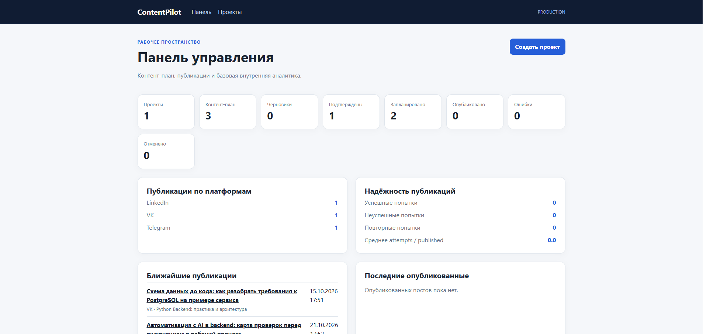
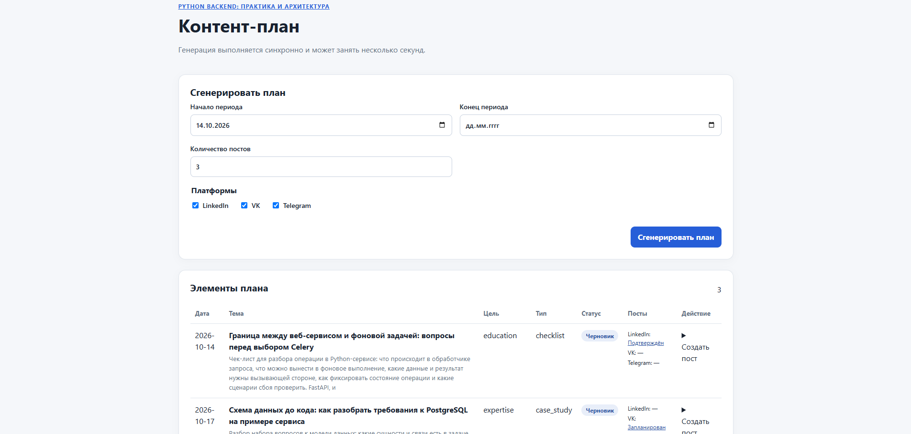
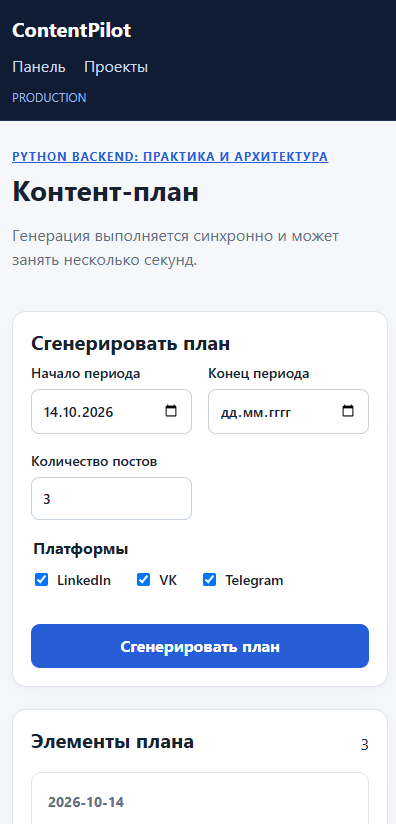
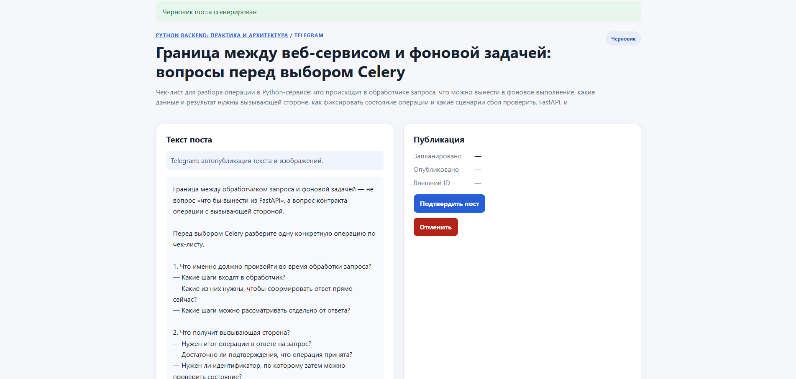
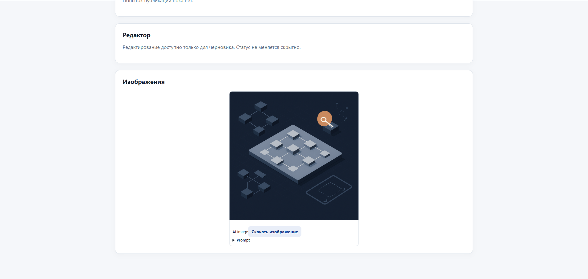
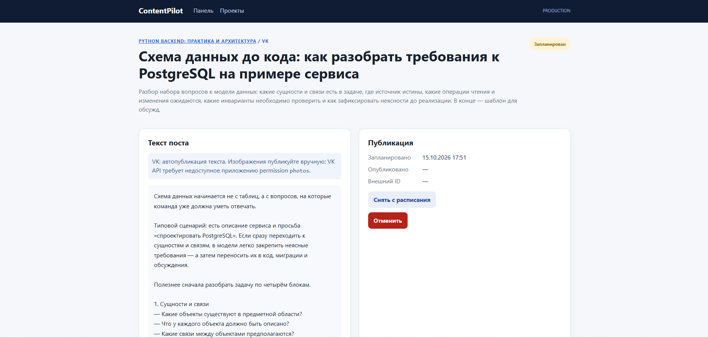

# ContentPilot

ContentPilot 0.1.0 — однопользовательский MVP для контент-планирования,
подготовки постов для социальных сетей, генерации изображений и планирования
публикаций. Это server-rendered приложение на FastAPI + Jinja2, рассчитанное
на русскоязычный рабочий процесс личного бренда разработчика.

## Возможности

- Генерация структурированного контент-плана через ProxyAPI с OpenAI-compatible API
- Отдельные версии постов для LinkedIn, VK и Telegram
- Генерация изображений и локальное хранение медиафайлов
- Редактирование черновиков, подтверждение и планирование публикаций
- Планировщик на PostgreSQL, Celery Beat, Redis и Celery worker с concurrency `1`
- Автоматическая публикация в Telegram и текстовая автопубликация в VK
- Ручный сценарий LinkedIn: копирование текста и скачивание изображения
- Dashboard с аналитикой и историей `PublicationAttempt`

## Архитектура

```text
Browser
  ↓
FastAPI + Jinja2
  ↓
PostgreSQL

AI generation → ProxyAPI

Celery Beat
  ↓
Redis
  ↓
Celery Worker
  ↓
Telegram / VK
  ↓
PostgreSQL
```

PostgreSQL — источник истины для расписания, состояния постов и попыток
публикации. Redis используется только как брокер Celery; generated media
хранятся в локальном томе, подключённом как `MEDIA_ROOT`.

## Технологический стек

- Python 3.12, FastAPI, Uvicorn, Jinja2, vanilla CSS/JavaScript
- PostgreSQL, SQLAlchemy 2, Alembic, psycopg
- Pydantic Settings, httpx, OpenAI SDK, ProxyAPI
- Redis, Celery Worker, Celery Beat
- pytest и Docker Compose

## Поддерживаемые платформы

| Платформа | Контент                        | Автопубликация                                  | Работа с изображением                          |
| --------- | ------------------------------ | ----------------------------------------------- | ---------------------------------------------- |
| LinkedIn  | Генерация текста и изображения | Только вручную                                  | Текст можно скопировать, изображение — скачать |
| VK        | Генерация текста и изображения | Текст публикуется автоматически                 | Изображение доступно для ручной публикации     |
| Telegram  | Генерация текста и изображения | Текст и изображение поддерживаются publisher-ом | Изображение отправляется через Bot API         |

Для VK автоматическая загрузка изображения намеренно не реализована:
официальный flow требует ограниченного пользовательского разрешения `photos`.
На текущем домашнем production-сервере прямой доступ к Telegram Bot API ограничен
сетевой средой; это ограничение инфраструктуры, а не отсутствие Telegram
publisher-а.

## Процесс публикации

Основной путь поста:

```text
draft → approved → scheduled → publishing → published
```

- `scheduled → approved` — снять пост с расписания;
- `approved → draft` — вернуть на редактирование или перегенерацию;
- `publishing → failed` — публикация не завершилась после автоматических
  повторных попыток;
- `failed → scheduled → publishing` — вручную повторить публикацию через
  существующий Celery pipeline для VK или Telegram;
- `failed → draft` — сохранить текст, изображение и историю попыток, очистив
  публикационное состояние;
- `draft`, `approved` и `scheduled` можно отменить.

Каждый вызов publisher-а создаёт `PublicationAttempt`. При recovery предыдущие
попытки и их номера сохраняются.

## Локальный запуск

Используйте Python 3.12 и Docker Desktop.

```powershell
Copy-Item .env.example .env
python -m pip install -e ".[dev]"
python -m pytest -q
docker compose up -d --build
docker compose exec content-pilot-api alembic upgrade head
```

Откройте `http://localhost:8002/`. Основные маршруты: `/`, `/projects`,
`/health` и `/api/health`. API и UI запускаются одним FastAPI container;
worker и Celery Beat поднимаются отдельными сервисами Docker Compose.

## Переменные окружения

Укажите надёжный `POSTGRES_PASSWORD`; `.env` игнорируется Git. `PROXYAPI_API_KEY`
нужен только для AI-генерации. Учётные данные соцсетей намеренно хранятся в
переменных окружения для этого однопользовательского MVP и передаются только в
контейнер worker.

```dotenv
# Publishing
PUBLISHING_DRY_RUN=false
SOCIAL_HTTP_TIMEOUT_SECONDS=30

# Telegram: выберите один режим.
# Direct Bot API
TELEGRAM_BOT_TOKEN=
TELEGRAM_CHAT_ID=

# Cloudflare Telegram Gateway
# HTTPS origin; ContentPilot добавляет /contentpilot/sendMessage и /sendPhoto
TELEGRAM_GATEWAY_BASE_URL=
CONTENTPILOT_GATEWAY_KEY=

# VK community
VK_ACCESS_TOKEN=
VK_GROUP_ID=
VK_API_VERSION=5.199
```

Для безопасной проверки scheduler используйте `APP_ENV=development` и
`PUBLISHING_DRY_RUN=true`. Будет выбран `DryRunPublisher`, который не выполняет
HTTP-запросов.

## Миграции базы данных

```powershell
docker compose exec content-pilot-api alembic current
docker compose exec content-pilot-api alembic upgrade head
docker compose exec content-pilot-api alembic check
```

Таблицами управляет только Alembic; при старте приложения не вызывается
`Base.metadata.create_all()`.

## Celery и планирование публикаций

Celery Beat периодически ставит UUID наступивших запланированных постов в
очередь. Worker атомарно переводит запись в `publishing`, создаёт
`PublicationAttempt`, вызывает адаптер публикации вне транзакции базы данных,
после чего сохраняет `published` или `failed`. Значение worker concurrency по
умолчанию — `1`.

```powershell
docker compose logs -f content-pilot-beat
docker compose logs -f content-pilot-worker
```

## CI/CD и production-развёртывание

GitHub Actions выполняет CI для `push` и `pull_request` в `main`: устанавливает
проект на Python 3.12, запускает pytest, compileall и production Docker build.
CI не получает production secrets, не вызывает ProxyAPI и не публикует посты.

После успешного CI для `push` в `main` workflow публикации собирает и
публикует образ в GHCR:

```text
ghcr.io/<github-owner>/content-pilot:latest
ghcr.io/<github-owner>/content-pilot:sha-<commit-sha>
```

Для production deploy используйте immutable SHA tag, а не только `latest`.
Production Compose находится в [`compose.prod.yaml`](compose.prod.yaml), а
серверный helper — в [`scripts/deploy.sh`](scripts/deploy.sh). Он получает
образ, поднимает PostgreSQL и Redis, один раз применяет Alembic migration,
запускает API, worker и Celery Beat, затем проверяет `/health`.
Watchtower намеренно не используется: обновления должны быть явными и
наблюдаемыми.

Production-файл `.env.production` создаётся только на сервере по примеру
[`.env.production.example`](.env.production.example). Не передавайте runtime
secrets в GitHub Actions: Telegram/VK credentials получает только worker.

Основной production deploy после подготовки серверного `.env.production`:

```bash
./scripts/deploy.sh
```

Скрипт по умолчанию использует `.env.production`, `compose.prod.yaml` и
`CONTENT_PILOT_IMAGE` из этого env-файла. Для разового deploy конкретного
immutable SHA tag можно переопределить образ через shell:

```bash
CONTENT_PILOT_IMAGE=ghcr.io/<github-owner>/content-pilot:sha-<commit-sha> ./scripts/deploy.sh
```

Для ручного удалённого deploy предусмотрен workflow `Deploy production` с GitHub
Environment `production`. На GitHub нужно настроить `DEPLOY_HOST`,
`DEPLOY_USER`, `DEPLOY_SSH_KEY`, `DEPLOY_KNOWN_HOSTS`, `DEPLOY_PATH` и при
необходимости `DEPLOY_PORT`. Подробная инструкция, server prerequisites,
rollback и GHCR access описаны в [`docs/deployment.md`](docs/deployment.md).

Минимальный rollback: укажите предыдущий `CONTENT_PILOT_IMAGE` с SHA tag и
снова запустите `./scripts/deploy.sh`. Automatic Alembic downgrade не
выполняется; rollback допустим только при обратной совместимости кода со
схемой базы данных.

## Социальные интеграции

TelegramPublisher поддерживает два режима: direct Telegram Bot API и Cloudflare
Telegram Gateway. Gateway получает Bearer key, а Bot Token и Channel ID хранит
на своей стороне. Для поста с изображением текст отправляется caption-ом, если
помещается в лимит Telegram; иначе publisher отправляет изображение и отдельное
полное текстовое сообщение. Gateway рекомендуется для environments, где прямой
доступ к `api.telegram.org` ограничен сетью.

VK использует официальный метод сообщества `wall.post`. Если у поста есть
сгенерированное медиа, ContentPilot всё равно публикует текст и оставляет
изображение доступным для ручной публикации. Приложение намеренно не вызывает
[`photos.getWallUploadServer`](https://dev.vk.ru/ru/method/photos.getWallUploadServer):
требуемое пользовательское разрешение `photos` ограничено для новых приложений
и в будущем потребует обращения в `devsupport@corp.vk.com`.

LinkedIn не использует API: для этой платформы доступны генерация, копирование
текста и скачивание изображения для ручной публикации.

## Ограничения MVP

- LinkedIn остаётся manual-only: официальный API access пока недоступен из-за
  проверки Page/аккаунта.
- VK не загружает изображения автоматически из-за ограничения permission
  `photos`; текстовая публикация при этом не считается ошибкой.
- Direct Telegram Bot API зависит от сети deployment environment. На текущем
  homeserver прямое соединение ограничено; для публикации используется
  Cloudflare Telegram Gateway. Gateway URL и Bearer key передаются только
  worker-у.
- Нет аутентификации, multi-user режима, хранения пользовательских credentials
  и внешней аналитики вовлечённости.
- Публикация имеет семантику at-least-once: если provider успел опубликовать
  пост, а worker завершился до фиксации успеха в PostgreSQL, последующая попытка
  теоретически может создать дубликат.

## Демо

Скринкаст показывает полный пользовательский сценарий: создание проекта,
генерацию контент-плана, поста и изображения, подтверждение, планирование
публикации, а также dashboard и аналитику.

[▶ Посмотреть демо-видео](https://drive.google.com/file/d/1eeB7ZvBmnANPpB6DAlq12PWDhvDnzkwD/view?usp=drive_link)

Рекомендуемый demo-проект: **«Личный бренд Python-разработчика»** с языком
`ru`, практичным профессиональным тоном и аудиторией Python-разработчиков,
технических специалистов, рекрутеров и нанимающих менеджеров. Полный checklist
для скриншотов и скринкаста — в
[`docs/release-checklist.md`](docs/release-checklist.md).

## Интерфейс

### Панель управления



### Контент-план



### Мобильная версия



### Работа с постом



### Генерация изображения



### Планирование публикации



## M0-спайки

[`scripts/spikes/README.md`](scripts/spikes/README.md) содержит независимые
ручные диагностические скрипты внешних интеграций. Они никогда не запускаются
через pytest или при обычном старте приложения; команды спайков Telegram и VK
могут создать реальные публикации.
